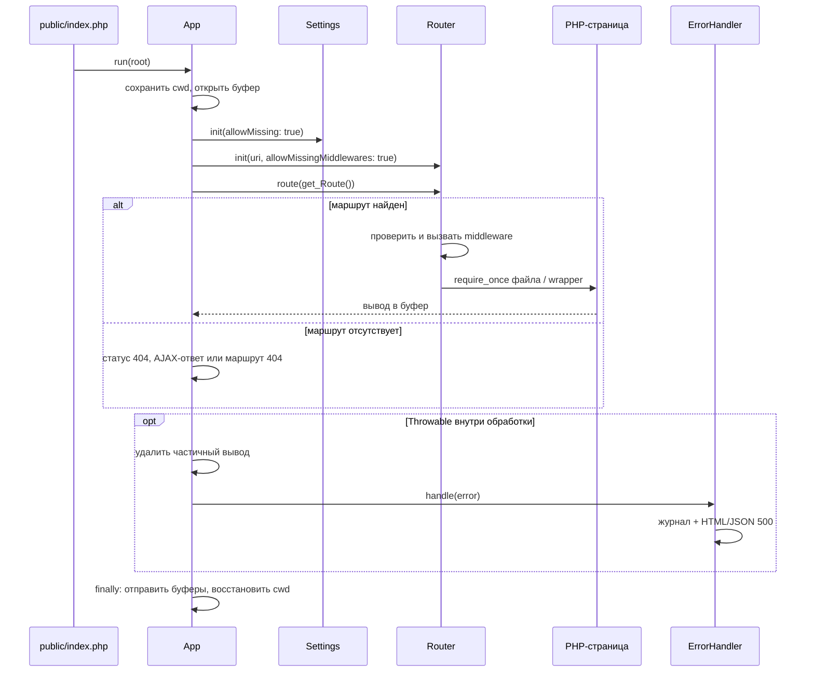
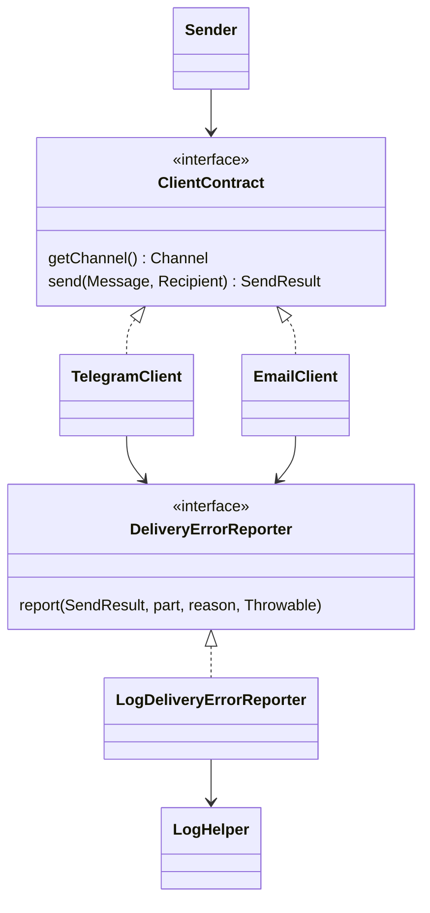

# Архитектура

[Обзор проекта](../readme.md)

## Устройство

SiteApi разделяет управление HTTP-запросом, прикладные PHP-страницы и адаптеры внешних сервисов. Пространство имён `SiteApi\` соответствует каталогу `src/` через Composer PSR-4.

| Компонент | Ответственность | Основные методы |
|---|---|---|
| `App` | Bootstrap, буфер, обработка результата | `run()` |
| `Settings` | Выбор источника и проверка типа настройки | `init()`, `getString()`, `getInt()`, `getBool()`, `getArray()` |
| `Router` | Сопоставление пути, middleware и включение файла | `init()`, `route()`, `redirectSafe()`, `reset()` |
| `ErrorHandler` | Диагностика и нейтральный ответ 500 | `handle()` |
| `Includer` | PHP-модули и однократное включение их стилей | `include_Module()`, `include_Headers()` |
| `DBHelper` | Выполнение SQL и одно PDO-соединение | `universal()`, `select()`, `beginTransaction()` |
| `CacheProvider` | Общий формат значений и пространство ключей | `set()`, `read()`, `remember()` |
| `Sender` | Выбор настроенного клиента доставки | `send()` |
| `LogHelper` | Регистрация событий и маскирование известных полей | `log()`, `error()` |

## Жизненный цикл HTTP-запроса

`App::run()` временно меняет рабочий каталог на корень приложения. Поэтому относительные пути страниц и стандартных каталогов разрешаются от него. В конце восстанавливает прежний каталог и значение Settings::$directory.

Настройки и middleware могут отсутствовать только в режиме, явно разрешённом bootstrap. Если файлы настроек есть, они проходят проверку. Каталог маршрутов обязателен.

`return` из успешной ветки не пропускает `finally`. Ошибки до `App::run()`, например загрузки Composer, находятся за пределами обработчика.

## Контракты и направления зависимостей

`Message`, `Recipient`, `Attachment` и `Link` описывают входные данные. `MessagePresentation` хранит общие правила экранирования и подписи. `SendResult` сохраняет исходы и вычисляет общий статус, но не пишет журнал. Клиенты получают реализацию регистрации ошибок через конструктор.

У кэша другой уровень разделения: `CacheProvider` кодирует PHP-значение, а `CacheContract` оперирует строками. Redis и Memcached отвечают только за хранение, срок и ошибки своего сервиса.

У логирования выбор реализации задаёт `LoggerEnum`; `LoggerProvider` предоставляет единый доступ к файловому или stdout-логгеру.

## SOLID и выбранные компромиссы

- Разделены данные, представление, доставка, результат и регистрация ошибок отправки.
- `Sender` зависит от интерфейса; транспорт можно подменить для тестов.
- Интерфейс доставки содержит два метода и не навязывает входящие события Telegram.
- Набор каналов намеренно закрыт enum: добавление канала потребует изменить `Channel` и валидацию получателя.
- Клиенты пока объединяют специфичное оформление и транспорт; отдельных фабрик и интерфейсов для каждого вызова нет.
- Статические Router, Settings и DBHelper удобны для небольшого приложения, но не являются полностью независимыми объектными сервисами.

Это прикладное разделение обязанностей, а не заявление о полном соблюдении всех принципов SOLID.

## Ошибки и диагностика

Разделены три вида исходов:

| Исход | Поведение |
|---|---|
| Маршрут отсутствует | `route()` возвращает false; App формирует 404 |
| Ошибка выполнения | Throwable перехватывается App; журнал и нейтральный 500 |
| Отказ внешней доставки / JSON HTTP-запроса | `SendResult` или false с категорией; приложение принимает решение |

SQL-параметры не логируются. Для PDO сохраняются безопасные коды, в том числе через ErrorHandler. Техническая ошибка получает `error_id`, совпадающий с кодом обращения на странице. Обычные ошибки не отправляют уведомления администратору автоматически.

## Ограничения

- Один `App::run()` на HTTP-запрос. Для Swoole/RoadRunner и конкурентных задач внутри процесса управление состоянием не реализовано.
- `Router::reset()` очищает собственное состояние, но не выгружает классы и не отменяет `require_once`.
- Общий wrapper повторно в том же запросе не выполняется из-за `require_once`.
- PHP-шаблоны, SQL-структура, имена файлов и inline JavaScript должны поступать из доверенного кода приложения.
- Данные Includer разделяют область видимости со служебным кодом. Не используйте ключи `module`, `vars`, `filename`, `key`, `key_value`.
- Буферизация не отменяет уже отправленные данные. Незакрываемый буфер прерывает очистку с записью причины, но чистый ответ тогда не гарантируется.
- `exit` / `die` не выполняют finally; потоковые ответы, скачивания и принудительная отправка буфера требуют отдельного сценария.
- Все зависимости обязательны для установки, даже если приложение использует часть модулей. Сами подключения остаются ленивыми.
- Повторы доставки и запросов не выполняются автоматически: после таймаута результат может быть неизвестен, а повтор способен создать дубликат.
