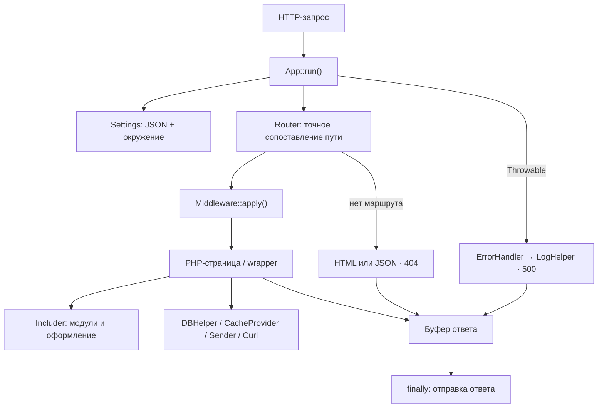
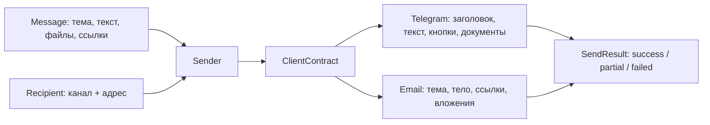

# SiteApi

Небольшой PHP-фреймворк для быстрой разработки сайтов и веб-приложений с единой точкой входа. Предоставляет маршрутизацию, middleware, подключение PHP-шаблонов, работу с БД и кэшем, логирование, защиту форм и отправку сообщений.

Создан как собственный простой инструмент, вдохновлённый подходами других фреймворков, в том числе Laravel.

SiteApi подходит для небольших сайтов, административных интерфейсов и приложений, где полезны обычные PHP-страницы и явно подключаемые сервисы. Код приложения остаётся обычным PHP: маршруты задаются массивами, шаблоны подключаются файлами, внешние сервисы имеют отдельные адаптеры.

## Архитектура



`App` отвечает за жизненный цикл запроса. `Router` выбирает обработчик. Прикладные страницы используют только необходимые им сервисы. Настройки и middleware необязательны для минимального запуска; подключения к внешним сервисам не выполняются автоматически.

Архитектурные решения, которые определяют поведение проекта:

| Решение | Практический результат |
|---|---|
| Единый bootstrap | Точка входа из двух вызовов; обработка ошибок и буфера не копируется между сайтами |
| Явные контракты клиентов | `Sender` получает реализации через `ClientContract`, выбирает канал по получателю |
| Разделение сообщения, оформления и результата | Одно сообщение представляется письмом или последовательностью Telegram-сообщений |
| Типизированное чтение настроек | JSON и переменные окружения проверяются по одинаковым правилам |
| Одно ленивое PDO-соединение на запрос | Последовательные операции используют общую транзакцию |
| Раздельные 404 и 500 | Отсутствующий маршрут не маскирует техническую ошибку; посетитель получает нейтральный ответ |
| Безопасные метаданные журналов | SQL-параметры и сырые ошибки PDO не записываются в журнал; отказ логгера не меняет исход операции БД |
| Явные результаты доставки | Успешная, частичная и неудачная отправка различаются без автоматических повторов |

Подробнее: [жизненный цикл, зависимости и компромиссы](docs/architecture.md).

## Структура исходников

```text
src/
├── App.php                       Жизненный цикл HTTP-запроса
└── Root/
    ├── Http/
    │   ├── Router.php            Маршруты, параметры, редиректы
    │   ├── ErrorHandler.php      Нейтральный ответ и код ошибки
    │   ├── Templates.php         Встроенные страницы 404 / 500
    │   ├── Includer.php          Подключение PHP-модулей
    │   ├── Contracts/            Контракт middleware
    │   └── Models/               Module и Vars
    ├── Settings/                 Настройки и режим приложения
    ├── Messenger/                Сообщение, получатель, контракты, результат
    ├── Clients/
    │   ├── Telegram/             Исходящие сообщения через Bot API
    │   ├── Email/                PHPMailer / SMTP
    │   └── CURL/                 Общий JSON HTTP-клиент
    ├── Providers/
    │   ├── Cache/                Redis / Memcached
    │   └── Logger/               Файл / stdout
    └── Helpers/                  PDO, CSRF, файлы, строки, метаданные ошибок
bin/siteapi                       Генератор приложения
tests/                            Автономные проверки и интеграционные сценарии
```

## Надёжность в деталях

Основной акцент реализации — на предсказуемом поведении пограничных случаев:

- Путь запроса отделяется от query string до нормализации, имена маршрутов сравниваются строго.
- Отсутствующее значение, неверный тип и явно заданный null не смешиваются при чтении настроек.
- Единственная строка БД проверяется как отдельный контракт; несколько совпадений вызывают исключение.
- PHP-типы параметров передаются в PDO явно; условия IS NULL не подменяются обычным сравнением.
- Частичный HTML удаляется перед обработкой исключения, а finally завершает ответ даже при раннем return.
- Сбой журнала не маскирует уже выполненную операцию записи в БД.
- Генератор приложения не перезаписывает файлы; обход каталогов защищён от циклов по ссылкам на предков.
- CSRF-токены случайны и связаны с сессией; данные для JavaScript экранируются отдельно от проверки имени переменной.

Эти решения закреплены сценариями в [tests/](tests), а совместимость публичных изменений описана в [миграции](docs/migration.md).

## Минимальное приложение

После установки библиотеки в проект:

```sh
vendor/bin/siteapi init .
php -S localhost:8000 -t public public/index.php
```

Генератор создаёт три файла и отказывается перезаписывать существующие:

```text
public/index.php   → точка входа
routes/web.php     → список маршрутов
pages/home.php     → первая страница
```

Точка входа:

```php
<?php
require dirname(__DIR__) . '/vendor/autoload.php';

SiteApi\App::run(dirname(__DIR__));
```

PHP ≥ 8.1. Все текущие модули входят в обязательную поставку; нужны расширения PHP, указанные в Composer. Для Redis используется Predis, для email — PHPMailer. Настройки серверов задаются отдельно.

[Установка, требования и запуск](docs/getting-started.md).

## Один формат сообщения — два канала



Получатель явно задаёт канал, а клиент отвечает за особенности доставки. Токены подключения не входят в сообщение. Результат хранит выполненные попытки и идентификаторы провайдера, регистрация ошибок вынесена в отдельный контракт.

[Примеры Telegram и email](docs/messaging.md).

## Проверяемое поведение

В репозитории есть исполняемые проверки конкретных границ: типов настроек, транзакций, `NULL`, SQL-логирования, ошибок HTTP, CSRF, экранирования JavaScript, точного выбора маршрутов и запуска сгенерированного приложения.

БД проверяется на настоящем PDO с SQLite. HTTP-клиент — на локальном сервере. Тесты отправки используют подмену транспорта и PHPMailer, чтобы не отправлять сообщения. Кэш имеет отдельный сценарий для настоящих Redis и Memcached.

Это различие важно: прохождение автономных тестов не подтверждает доставку SMTP/Telegram и совместимость всех запросов с MySQL. Текущий статус и команды: [проверки](docs/testing.md).

## Документация

| Раздел | Содержание |
|---|---|
| [Начало работы](docs/getting-started.md) | Установка, генератор, сервер и структура приложения |
| [Архитектура](docs/architecture.md) | Жизненный цикл, зависимости, контракты и ограничения |
| [HTTP и шаблоны](docs/http.md) | Маршруты, middleware, параметры, AJAX, редиректы, модули |
| [Настройки](docs/configuration.md) | JSON, окружение, типы, пути и режим |
| [База данных](docs/database.md) | PDO, условия, транзакции, подсчёт и журналирование |
| [Отправка сообщений](docs/messaging.md) | Telegram, SMTP, вложения, ссылки и частичные ошибки |
| [Сервисы и безопасность](docs/services.md) | Кэш, логирование, CURL, CSRF и вспомогательные методы |
| [Проверки](docs/testing.md) | Что проверено автоматически и что требует внешних сервисов |
| [Миграция](docs/migration.md) | Изменения публичного API и поведения |

## Границы проекта

SiteApi рассчитан на один запуск приложения в рамках обычного PHP-FPM/Apache-запроса. В нём нет ORM, контейнера зависимостей, очередей, движка диалогов или встроенной системы пользователей. Авторизация, правила входных данных и прикладная логика остаются в приложении.

Прямое подключение PHP-файлов и статические фасады сокращают объём инфраструктуры, но требуют дисциплины работы с состоянием. Особенности повторных подключений, доверенных шаблонов и долгоживущих процессов описаны в [архитектурных ограничениях](docs/architecture.md#ограничения).
